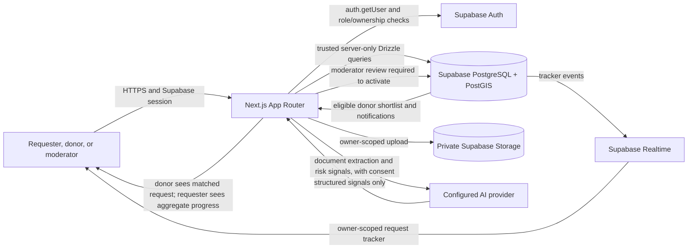

# LifeLink Architecture and Data Flow

## Current application flow

## Request flow

1. A requester signs in and submits the required request fields and supporting document to a Next.js API route.
2. The route validates the session, requester role, fields, file signature/type/size and document-analysis consent. It uploads the document to the private bucket and inserts a `pending_verification` request through Drizzle.
3. Verification routes compare extracted document fields and calculate risk signals. AI output is a signal; a failure leaves the request pending. Flagged cases move to `under_review` for a moderator.
4. An allowlisted moderator reviews the request and can request more information, reject it, or approve it if required gates are complete. Approval changes it to `active` and creates eligible-donor notifications.
5. Donors see only matching active requests through the donor-specific API. They can pledge/confirm coordination/withdraw. The requester tracker exposes aggregate counts and status, not donor identities.
6. The requester or authorized moderator can fulfill/cancel an active request. Hospital or licensed blood-bank staff determine actual compatibility and medical eligibility.

## Trust boundaries and known gaps

- Supabase Auth validates user sessions. Most private application reads/writes use Drizzle from trusted Next.js server code, which uses the database connection role and bypasses user RLS; authorization must happen in the route before each query.
- Supabase browser clients use the anon key and RLS. The profile policy in `supabase/auth_profile_setup.sql` previously allowed every authenticated account to read all profiles. Migration `202610100006_private_profile_reads.sql` narrows direct reads to the owner's profile and adds a restrictive owner guard. It has been applied to the database configured in `.env.local`; whether that target is staging or production is not recorded.
- Supporting documents are in a private bucket. Requesters may access their own object path; moderator document access uses a five-minute signed URL after moderator authorization.
- AI currently runs through request routes and is not an asynchronous queue. Model failure is handled by keeping the request pending for retry/review.
- Public approved-request pages, social sharing, contact reveal/chat, account export/deletion, expiry scheduler, push delivery, and Telegram intake are not implemented yet.
- The public landing request feed currently uses hard-coded example data. Treat it as demo content, not a live database feed or a source of verified requests.

