# Request State Machine

## Current database statuses

The current `request_status` enum is:

`pending_verification`, `under_review`, `active`, `fulfilled`, `rejected`, `cancelled`.

The app has a separate `review_state`: `open` or `needs_information`. There is no `partially_fulfilled` or `expired` request status yet. Pledges and confirmed coordination are not proof that a donation occurred.

```mermaid
stateDiagram-v2
  [*] --> pending_verification: requester submits
  pending_verification --> pending_verification: checks pass or need retry
  pending_verification --> under_review: screening flags / moderator requests information
  under_review --> under_review: requester responds; moderator review continues
  pending_verification --> active: authorized moderator approves after required checks
  under_review --> active: authorized moderator approves after required checks
  pending_verification --> rejected: authorized moderator rejects
  under_review --> rejected: authorized moderator rejects
  active --> fulfilled: requester or authorized moderator closes as fulfilled
  active --> cancelled: requester or authorized moderator cancels
  fulfilled --> [*]
  rejected --> [*]
  cancelled --> [*]
```

## Who may cause each transition

| From | To / action | Who | Conditions |
|---|---|---|---|
| New | `pending_verification` | Authenticated requester | Request fields and private document validate; document-analysis consent is recorded. |
| `pending_verification` | `under_review` | Verification route | A document or risk screen flags the request. AI does not approve it. |
| `pending_verification` or `under_review` | `under_review` + `needs_information` | Moderator | Moderator role and user ID allowlist both pass; reason is recorded. |
| `under_review` + `needs_information` | `under_review` + `open` | Requester sends a clarification; moderator later reviews it | Requester owns the request. The response itself does not approve or activate it. |
| `pending_verification` or `under_review` | `active` | Authorized moderator | Basic validation, document analysis, risk screening and hospital location are complete. Flagged approvals require a reason. Activation creates eligible donor notifications. |
| `pending_verification` or `under_review` | `rejected` | Authorized moderator | Reason is recorded in moderation audit. |
| `active` | `fulfilled` | Requester owner or authorized moderator | Current API permits closure only from `active`. A pledge is not proof of donation; actual clinical confirmation is external to current code. |
| `active` | `cancelled` | Requester owner or authorized moderator | Current API permits closure only from `active`. |

## Not implemented yet

- Automatic `expired` transition and expiry scheduler.
- `partially_fulfilled` based on confirmed donation units.
- Separate donor acceptance, in-app chat/contact reveal, hospital-confirmed donation entity, and reveal cleanup.
- Public request links; if added in Phase 5, only approved `active` requests should have public details. Closed links should show a closed state, not current request details.

